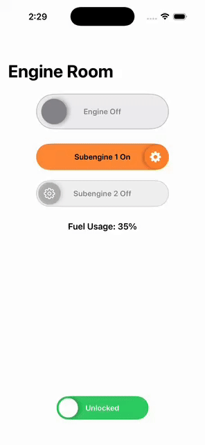

# FlatSwitch

A SwiftUI reimagining of the classic FlatSwitch component. Drop in a capsule-style, label-aware toggle with configurable colors, icons, sizing, and animation—no UIKit or Interface Builder required.



## Requirements

- Swift 5.9+
- iOS 15 / macOS 12 / tvOS 15 / watchOS 8 or newer

## Installation (Swift Package Manager)

Add the package to your project:

```swift
dependencies: [
    .package(url: "https://github.com/deya-eldeen/FlatSwitch.git", from: "1.0.0")
]
```

Then include `FlatSwitch` as a dependency of your target and import it where needed:

```swift
import FlatSwitch
```

## Usage

```swift
import SwiftUI
import FlatSwitch

struct ContentView: View {
    @State private var isOn = true

    var body: some View {
        VStack(spacing: 24) {
            FlatSwitch("Notifications", isOn: $isOn)

            FlatSwitch("Lighting", isOn: $isOn, configuration: .init(
                onState: .init(
                    background: .yellow.opacity(0.85),
                    borderColor: .orange,
                    title: "On",
                    titleColor: .black,
                    thumbColor: .orange,
                    thumbIcon: .system(name: "lightbulb.fill"),
                    thumbShadowX: -3
                ),
                offState: .init(
                    background: Color.gray.opacity(0.12),
                    borderColor: Color.gray.opacity(0.35),
                    title: "Off",
                    titleColor: Color.gray,
                    thumbColor: Color.gray.opacity(0.45),
                    thumbIcon: .system(name: "lightbulb.slash"),
                    thumbShadowX: 3
                ),
                height: 52,
                width: 130
            ))
        }
        .padding()
    }
}
```

## Example app

A SwiftUI sample is included, in Example folder, see above gif.

## Configuration Highlights

- `FlatSwitchState` lets you set per-state background/border colors, label text and color, thumb color, icon, and thumb shadow direction.
- `FlatSwitchConfiguration` controls sizing (height/width, border, thumb inset), typography, animation, and accessibility label.
- Honors `\Environment(\.isEnabled)` to visually dim when disabled.

## License

FlatSwitch is available under the MIT license. See the LICENSE file for more info.
